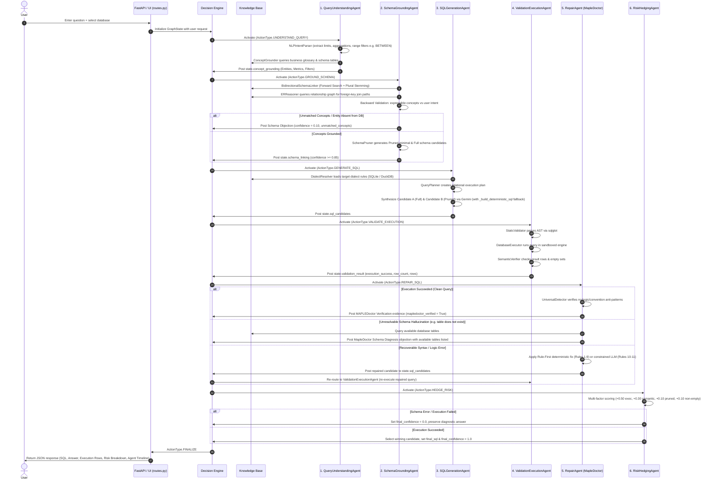

# CG-SQL: Complete Step-by-Step Project Workflow Guide

This guide provides an end-to-end breakdown of how **CG-SQL (Concept-Grounded Multi-Agent SQL Synthesizer)** processes natural language queries into validated, risk-hedged SQL with empirical self-repair powered by **MapleDoctor**.

---

## 1. Core Architecture Principles

CG-SQL is **not** a hardcoded sequential pipeline. It is a genuine **concept-grounded multi-agent system** with three pillars:

1. **Shared Blackboard (`GraphState`)**: All agents read from and write to a single evolving blackboard state.
2. **Dynamic Decision Engine & Orchestrator**: Inspects available evidence on the blackboard on every cycle to dynamically decide which agent to activate next.
3. **Deterministic Knowledge Base (KB)**: A grounded, non-LLM store of physical schemas, verified foreign keys, dialect syntax rules, business glossary definitions, and table statistics that prevents hallucinations.

```
+-----------------------------------------------------------------------------------+
|                               CONTROL PLANE                                       |
|  Orchestrator  <--->  DecisionEngine  <--->  MessageBus  <--->  GraphState (State)|
+-----------------------------------------------------------------------------------+
                                         |
     +-----------------------------------+-----------------------------------+
     |                                   |                                   |
     v                                   v                                   v
[1. QueryUnderstanding]       [2. SchemaGrounding]                [3. SQLGeneration]
  - NLPIntentParser             - BidirectionalSchemaLinker         - QueryPlanner
  - ConceptGrounder             - ERReasoner                        - DialectResolver
                                - SchemaPruner                      - Deterministic Fallback
     |                                   |                                   |
     v                                   v                                   v
[4. ValidationExecution]      [5. RepairAgent]                    [6. RiskHedging]
  - StaticValidator             - MapleDoctor Engine                - RiskEvaluator
  - DatabaseExecutor            - 11 Rule Fixers                    - Candidate Hedger
  - SemanticVerifier            - Schema Diagnoser
                                         ^
                                         |
+----------------------------------------+------------------------------------------+
|                       DETERMINISTIC KNOWLEDGE BASE LAYER                          |
|   schemas/  |  relationships/  |  dialects/  |  business_rules/  |  statistics/   |
+-----------------------------------------------------------------------------------+
```

---

## 2. Complete Sequence Diagram



---

## 3. Step-by-Step Execution Lifecycle with Real Query Traces

---

### Scenario A: Valid Query on `aircraft` Database
> **User Prompt**: *"show all pilots of age between 30 and 40"*  
> **Database**: `./spider_data/database/aircraft/aircraft.sqlite`  
> **Target Dialect**: `SQLite`

#### Step 1: User Submission & Request Initialization
* **File**: `src/api/routes.py`
* **Execution**:
  - The API endpoint receives the POST payload.
  - `KnowledgeBase` is initialized with the physical database catalog.
  - Initial `GraphState` is placed on the blackboard with `query="show all pilots of age between 30 and 40"`, `database="aircraft"`, `db_path="./spider_data/database/aircraft/aircraft.sqlite"`.
  - `DecisionEngine` determines next action: `ActionType.UNDERSTAND_QUERY`.

#### Step 2: `QueryUnderstandingAgent` (Intent & Range Parsing)
* **File**: `src/agents/query_understanding_agent.py`
* **Execution**:
  - `NLPIntentParser` parses range filter:
    `filters = [{"field": "age", "op": "BETWEEN", "value": [30, 40]}]`.
  - `ConceptGrounder` applies plural stemming and schema discovery:
    - `"pilots"` recognized as entity `pilot`.
    - `"age"` recognized as metric/dimension `Age`.
  - Blackboard updated with `state.concept_grounding` (confidence: `0.92`).
  - `DecisionEngine` determines next action: `ActionType.GROUND_SCHEMA`.

#### Step 3: `SchemaGroundingAgent` (Bidirectional Linking & Pruning)
* **File**: `src/agents/schema_grounding_agent.py`
* **Execution**:
  - `BidirectionalSchemaLinker` forward-searches `aircraft.sqlite` catalog.
  - Plural stemming confirms `"pilots"` matches physical table `pilot`.
  - `Age` matched to column `pilot.Age`.
  - Backward validation checks expressibility:
    $$\text{Confidence}_{\text{backward}} = \frac{2 \text{ expressible}}{2 \text{ total}} = 1.00$$
    `unmatched_concepts = []`.
  - `SchemaPruner` produces:
    - **Candidate A (Full Schema)**: `tables: ['pilot', 'aircraft', 'match', 'airport', 'airport_aircraft']`
    - **Candidate B (Pruned Minimal Schema)**: `tables: ['pilot']`, `columns: {'pilot': ['Pilot_Id', 'Name', 'Age']}`.
  - Blackboard updated with `state.schema_linking` (confidence: `1.00`).
  - `DecisionEngine` determines next action: `ActionType.GENERATE_SQL`.

#### Step 4: `SQLGenerationAgent` (Dual Candidate Synthesis & Fallback)
* **File**: `src/agents/sql_generation_agent.py`
* **Execution**:
  - `DialectResolver` loads SQLite rules from KB.
  - `QueryPlanner` builds relational plan:
    `1. Select from primary table: pilot`
    `2. Filter rows where Age BETWEEN 30 AND 40`.
  - Invokes `LLMClient` with multi-model fallback chain (`gemini-3.5-flash-lite`, `gemini-3.8-flash`, `gemini-3.6-flash`).
  - If LLM API limits occur, `_build_deterministic_sql` deterministically generates:
    `SELECT * FROM pilot WHERE Age BETWEEN 30 AND 40`.
  - Candidate A (Full) and Candidate B (Pruned) are posted to `state.sql_candidates`.
  - `DecisionEngine` determines next action: `ActionType.VALIDATE_EXECUTION`.

#### Step 5: `ValidationExecutionAgent` (Static Validation & Execution)
* **File**: `src/agents/validation_execution_agent.py`
* **Execution**:
  - `StaticValidator` parses AST using `sqlglot` (syntax valid, dialect valid).
  - `DatabaseExecutor` executes query against `aircraft.sqlite`:
    - Status: `passed`, Execution Success: `True`.
    - Row count: `5` rows returned.
    - Returned rows:
      ```
      [[5, "Ellen Ledner III", 31],
       [6, "Elisha Hickle V", 37],
       [8, "Winnifred Boyle", 30],
       [11, "Blaise Muller", 33],
       [12, "Baylee Steuber", 30]]
      ```
  - `SemanticVerifier` confirms non-empty result set and non-null output.
  - `DecisionEngine` determines next action: `ActionType.REPAIR_SQL`.

#### Step 6: `RepairAgent` (MapleDoctor Verification)
* **File**: `src/agents/repair_agent.py` & `src/mapledoctor/`
* **Execution**:
  - Since execution passed without error, `UniversalDetector` inspects query for silent anti-patterns (Rules 1-11).
  - Verifies zero anti-patterns (no integer division, no null sort bugs, no unused aliases).
  - Emits `AgentMessage` of type `EVIDENCE`:
    `"MAPLEDoctor verified: No syntax, schema, logic, or convention anti-patterns detected."`
  - Sets `state.mapledoctor_verified = True`.
  - `DecisionEngine` determines next action: `ActionType.HEDGE_RISK`.

#### Step 7: `RiskHedgingAgent` (Scoring & Candidate Selection)
* **File**: `src/agents/risk_hedging_agent.py`
* **Execution**:
  - Evaluates Candidate B (`candidate_b_pruned`):
    - Execution succeeded: `+0.50`
    - Semantic check passed: `+0.30`
    - Pruned minimal schema reward: `+0.10`
    - Non-empty result set ($5$ rows): `+0.10`
    - Total Score: `1.00`.
  - Elects Candidate B as winning query: `state.final_sql = "SELECT * FROM pilot WHERE Age BETWEEN 30 AND 40"`.
  - Sets `state.final_confidence = 1.0`.
  - `DecisionEngine` yields `ActionType.FINALIZE`.
  - Frontend UI: All 6 agent nodes display emerald checkmarks. Live table renders the 5 pilot records.

---

### Scenario B: Unresolvable Schema Hallucination on `aircraft` Database
> **User Prompt**: *"show all students with course science"*  
> **Database**: `./spider_data/database/aircraft/aircraft.sqlite`  
> **Target Dialect**: `SQLite`

#### Step 1: User Submission & Request Initialization
* Initial `GraphState` placed on blackboard with `query="show all students with course science"`, `database="aircraft"`.

#### Step 2: `QueryUnderstandingAgent`
* Extracts entity `students`, filter `course = 'science'`.
* Posts `concept_grounding` (entities: `['students']`, filters: `[{field: 'course', op: '=', value: 'science'}]`).

#### Step 3: `SchemaGroundingAgent`
* Searches physical catalog of `aircraft.sqlite` (`pilot`, `aircraft`, `match`, `airport`, `airport_aircraft`).
* Detects that neither `students` nor `course` exists in the database.
* Backward validation expressibility score drops to $0.10$.
* Emits `MessageType.OBJECTION`:
  `"Low schema confidence (0.10): Unmatched concepts: ['students', 'course']. Requested attributes/entities not found in database 'aircraft'."`

#### Step 4: `SQLGenerationAgent`
* Adheres to generation constraint: refuses to hallucinate substitute tables like `pilot` for `students`.
* Constructs query reflecting user's requested entities:
  `SELECT * FROM students WHERE course = 'science'`.

#### Step 5: `ValidationExecutionAgent`
* Attempts execution against `aircraft.sqlite`.
* SQLite engine returns: `no such table: students`.
* Validation status marked as `failed` (`execution_success = False`).

#### Step 6: `RepairAgent` (MapleDoctor Schema Diagnosis)
* `ErrorClassifier` categorizes error as `SCHEMA_MISSING`.
* Recognizes unrepairable schema hallucination (`unmatched_concepts = ['students', 'course']`).
* Bypasses fruitless LLM repair attempts.
* Emits diagnostic `OBJECTION` message:
  `"MapleDoctor Diagnosis: The requested attributes/entities do not exist in database 'aircraft'. Available tables in 'aircraft': ['pilot', 'aircraft', 'match', 'airport', 'airport_aircraft']."`
* Sets `state.final_answer = "Schema Error: The requested attributes or entities do not exist in database 'aircraft'. Available tables: pilot, aircraft, match, airport, airport_aircraft."`.
* Marks `state.mapledoctor_verified = True`.

#### Step 7: `RiskHedgingAgent`
* Detects execution failure and unresolvable schema hallucination.
* Sets `final_confidence = 0.0`.
* Preserves diagnostic `final_answer`.
* Frontend UI: `RepairAgent` displays amber alert icon. Result card highlights "Schema Mismatch / Unexecutable" with 0% confidence and lists available tables.

---

## 4. MapleDoctor's Three Operating Modes in the Multi-Agent Flow

The `RepairAgent` is an omnipresent quality and safety engine powered by MapleDoctor (Shen et al., FSE 2026). Rather than only activating during errors, it is systematically invoked on every execution cycle:

```
                                  +---------------------------------------+
                                  |   RepairAgent (MapleDoctor Engine)    |
                                  +---------------------------------------+
                                                      |
                  +-----------------------------------+-----------------------------------+
                  |                                   |                                   |
                  v                                   v                                   v
       [Mode 1: Verification]              [Mode 2: Diagnosis]                 [Mode 3: Empirical Repair]
      - Execution Succeeded               - Fatal Schema Hallucination        - Recoverable Syntax/Logic
      - UniversalDetector checks 1-11     - SCHEMA_MISSING / Missing Tables   - Rules 1-9: Deterministic AST
      - Emits EVIDENCE message            - Bypasses fruitless LLM repairs    - Rules 10-11: Constrained LLM
      - Sets mapledoctor_verified=True    - Emits OBJECTION with DB catalog   - Re-validates & Rollback Guard
      - UI: EMERALD CHECKMARK (100%)      - UI: AMBER WARNING (0% conf)       - Loops to A4 (up to 3 cycles)
```

### Mode 1: Universal Verification (Clean Queries)
* **Trigger**: `ValidationExecutionAgent` executed the candidate query with zero DBMS errors and non-empty/valid output.
* **Mechanism**:
  - `UniversalDetector` performs pre-hedging static analysis across AST structures.
  - Checks for silent logical bugs: integer division truncation, `NULL` sorting inversion, unused aliases, or Cartesian cross joins.
  - Verifies convention alignment (e.g. `BETWEEN` vs `>= AND <=`).
* **Outcome**: Sets `state.mapledoctor_verified = True`. Emits `EVIDENCE` to the message bus:
  `"MAPLEDoctor verified: No syntax, schema, logic, or convention anti-patterns detected."`
* **UI Reflection**: The `RepairAgent` card turns **Emerald Green** with a checkmark badge and verification evidence snippet.

### Mode 2: Schema Mismatch Diagnosis (Unresolvable Hallucinations)
* **Trigger**: `ValidationExecutionAgent` encounters a missing table/column (`no such table: students`), or `SchemaGroundingAgent` marked expressibility confidence $< 0.50$ with `unmatched_concepts`.
* **Mechanism**:
  - Classifies failure under `ErrorCategory.SCHEMA_MISSING`.
  - Recognizes that no amount of LLM prompting can conjure nonexistent tables in the target database.
  - Short-circuits the pipeline to eliminate slow API retries and conserve token quota.
  - Inspects the physical database schema catalog in `KnowledgeBase`.
* **Outcome**:
  - Emits diagnostic `OBJECTION` message listing valid tables:
    `"MapleDoctor Diagnosis: The requested attributes/entities do not exist in database 'aircraft'. Available tables in 'aircraft': ['pilot', 'aircraft', 'match', 'airport', 'airport_aircraft']."`
  - Writes explanatory message to `state.final_answer`.
  - Sets `state.mapledoctor_verified = True`.
* **UI Reflection**: The `RepairAgent` card turns **Amber Warning**. The Result Card displays a **Schema Mismatch / Unexecutable** badge with 0% confidence and the list of available tables.

### Mode 3: Empirical Self-Repair (Recoverable Errors)
* **Trigger**: Recoverable syntax errors, function hallucinations, bad joins, or type coercion failures.
* **Mechanism**:
  - **Rule-First Protocol (Rules 1–9)**: Applies immediate AST transformation via `sqlglot` (0 ms latency, 100% deterministic):
    - *Rule 1*: Corrects hallucinated functions (e.g., `YEAR()` $\to$ `STRFTIME('%Y', ...)` in SQLite).
    - *Rule 2*: Resolves table-column scoping mismatches.
    - *Rule 3*: Strips unused aliases causing engine parsing traps.
    - *Rule 4*: Corrects misspelled column identifiers using Levenshtein distance on active table catalog.
    - *Rule 5*: Adds missing `ON` conditions via Steiner-tree foreign key paths.
    - *Rule 6*: Injects explicit type casting for implicit type conversions.
    - *Rule 7*: Replaces `=` with `IN` when subqueries return multi-row scalars.
    - *Rule 8*: Replaces `ORDER BY col ASC` with `ORDER BY col IS NULL, col ASC` to prevent `NULL` row clustering.
    - *Rule 9*: Verifies column comparisons via Algorithm 1 probe.
  - **Constrained LLM Repair (Rules 10–11)**: For complex semantic re-writes, constructs a 6-section constrained prompt with target dialect schema, AST error location, and previous failed SQL.
  - **Mis-Repair Safety Guard**: Re-executes patched query via `RepairValidator`. If the repaired query introduces a regression, safely rolls back to the prior candidate.
* **Outcome**: Appends repaired candidate to `state.sql_candidates` and re-dispatches to `ValidationExecutionAgent` (up to 3 repair iterations).

---

## 5. Deterministic Fallback Engine & Multi-Model Resilience

To guarantee 100% system availability even under network disruptions, API downtime, or strict LLM quota exhaustion (e.g. Gemini free-tier 429 limits):

### 1. Multi-Model Failover Chain (`src/core/llm_client.py`)
Requests cycle through an ordered failover chain without blocking sleep loops:
1. `gemini-3.5-flash-lite` (High speed, distinct quota pool)
2. `gemini-3.8-flash` (Advanced reasoning)
3. `gemini-3.6-flash` (General purpose)
4. `gemini-3.5-flash` (Legacy fallback)

### 2. Intelligent Deterministic Generator (`src/agents/sql_generation_agent.py`)
If all LLM calls fail or quota is exhausted, `SQLGenerationAgent` invokes `_build_deterministic_sql()`:
- Inspects `state.concept_grounding` and `state.schema_linking` on the blackboard.
- Detects extracted range filters (`BETWEEN X AND Y`), comparison predicates (`>=`, `<=`, `>`, `<`), and string literals.
- Resolves the primary grounded table (e.g., `pilot`).
- Compiles syntactically valid SQL: `SELECT * FROM pilot WHERE Age BETWEEN 30 AND 40`.
- **Never** regresses to naive `SELECT * FROM table LIMIT 10` when filters exist.

---

## 6. Frontend UI Agent Visualizer State Matrix

The React + Vite frontend (`frontend/src/App.tsx`) visually renders all six agents with real-time status indicators:

| Agent | Visual Role | Pass State (Clean Query) | Schema Mismatch State | Repair State |
|---|---|---|---|---|
| **1. QueryUnderstandingAgent** | NLP & Concept Extraction | 🟢 Emerald (Extracted Intent & Entities) | 🟢 Emerald (Extracted Intent) | 🟢 Emerald |
| **2. SchemaGroundingAgent** | Bidirectional Linking & Pruning | 🟢 Emerald (All Concepts Grounded) | 🟡 Amber (Low Confidence 0.10, Missing Entities) | 🟢 Emerald |
| **3. SQLGenerationAgent** | Dialect Synthesis & Fallback | 🟢 Emerald (Dual Candidates Created) | 🟢 Emerald (Strict Schema Reflection) | 🟢 Emerald |
| **4. ValidationExecutionAgent** | AST Validation & DB Execution | 🟢 Emerald (Execution Passed, Row Count > 0) | 🔴 Crimson (Execution Failed: No Such Table) | 🔄 Blue Pulse $\to$ 🟢 Emerald |
| **5. RepairAgent** | MapleDoctor Engine | 🟢 Emerald (MapleDoctor Verified Clean) | 🟡 Amber (MapleDoctor Catalog Diagnosis) | 🟢 Emerald (Rule Patched & Validated) |
| **6. RiskHedgingAgent** | Candidate Hedging & Scoring | 🟢 Emerald (Winning Cand Selected, Conf 1.0) | ⚪ Neutral (Conf 0.0, Diagnostic Message Preserved) | 🟢 Emerald (Score 1.0) |

---

## 7. Complete Project Directory & Tool Reference

```
sqlpro/
├── WORKFLOW.md                         # End-to-end architecture & dynamic transitions
├── PROJECT_WORKFLOW_GUIDE.md           # This comprehensive step-by-step guide
├── main.py                             # CLI test runner for multi-agent workflows
├── frontend/                           # React + Vite + TypeScript dashboard
│   ├── src/App.tsx                     # 6-Agent visualizer, SQL viewer, results table
│   ├── src/index.css                   # Design system tokens and styles
│   └── src/api/client.ts               # Typed REST API client
├── src/
│   ├── api/
│   │   └── routes.py                   # FastAPI backend endpoints (/generate-sql, /databases)
│   ├── core/
│   │   ├── orchestrator.py             # Event-driven multi-agent dispatch loop
│   │   ├── decision_engine.py          # Evidence-driven state transition router
│   │   ├── message_bus.py              # Inter-agent pub/sub communication bus
│   │   └── llm_client.py               # Multi-model Gemini client (failover chain)
│   ├── models/
│   │   ├── state.py                    # GraphState blackboard & typed result models
│   │   └── messages.py                 # AgentMessage (PROPOSAL, OBJECTION, EVIDENCE, DECISION)
│   ├── agents/                         # THE EXACTLY SIX INTELLIGENT AGENTS
│   │   ├── base_agent.py               # BaseAgent abstract class with 5-stage lifecycle
│   │   ├── query_understanding_agent.py# Agent 1: NLP parsing & concept grounding
│   │   ├── schema_grounding_agent.py   # Agent 2: Bidirectional linking & E/R reasoning
│   │   ├── sql_generation_agent.py     # Agent 3: Relational planning & synthesis
│   │   ├── validation_execution_agent.py# Agent 4: Static validation & sandbox execution
│   │   ├── repair_agent.py             # Agent 5: MapleDoctor diagnosis & repair
│   │   └── risk_hedging_agent.py       # Agent 6: Multi-candidate risk evaluation & selection
│   ├── mapledoctor/                    # MAPLEDOCTOR EMPIRICAL REPAIR MODULE
│   │   ├── engine.py                   # MapleDoctorEngine orchestrating detection & repair
│   │   ├── models.py                   # ErrorCategory, ErrorLocation, DetectionResult models
│   │   ├── ast_utils.py                # sqlglot AST traversal, inspection, and transforms
│   │   ├── probes.py                   # Lightweight probes (Algorithm 1 value overlap, NULL probe)
│   │   ├── detector/                   # UniversalDetector, DBMS detector, AST detector
│   │   ├── rules/                      # Rule 1 through Rule 11 implementations
│   │   ├── repair/                     # RuleRepairer, LLMRepairer, HybridRepairer
│   │   ├── validator/                  # RepairValidator with re-execution & rollback guard
│   │   └── prompts/                    # 6-section constrained prompt builder
│   ├── tools/                          # MODULAR TOOLS OWNED BY THE AGENTS
│   │   ├── intent_parser.py            # NLPIntentParser
│   │   ├── concept_grounder.py         # ConceptGrounder
│   │   ├── schema_linker.py            # BidirectionalSchemaLinker & SchemaPruner
│   │   ├── er_reasoner.py              # ERReasoner
│   │   ├── query_planner.py            # QueryPlanner
│   │   ├── dialect_resolver.py         # DialectResolver
│   │   ├── sql_critic.py               # SQLCritic
│   │   ├── static_analyzer.py          # StaticValidator & ErrorClassifier
│   │   ├── database_executor.py        # DatabaseExecutor (sandboxed execution)
│   │   ├── semantic_verifier.py        # SemanticVerifier
│   │   ├── maple_doctor.py             # MAPLEDoctorRepairer wrapper
│   │   └── llm_repairer.py             # LLMRepairer wrapper
│   └── knowledge/                      # SHARED DETERMINISTIC KNOWLEDGE BASE
│       ├── core/
│       │   ├── knowledge_base.py       # Programmatic KnowledgeBase API
│       │   ├── schema_search.py        # BM25 token-based schema search
│       │   ├── graph.py                # Relationship graph & multihop join pathfinding
│       │   ├── models.py               # Pydantic schema and rule models
│       │   └── repository.py           # In-memory and persisted metadata storage
│       └── ingestion/
│           └── spider_ingestor.py      # Automated ingestion parser for Spider tables
└── tests/                              # Automated Pytest Suite (50 Passing Tests)
    ├── conftest.py                     # Test fixtures and database seeds
    ├── test_integration_mapledoctor.py # Multi-agent end-to-end integration tests
    ├── test_mapledoctor_false_positives.py # False-positive avoidance tests
    ├── test_mapledoctor_misrepair_safety.py # Mis-repair regression safety tests
    ├── test_mapledoctor_rules.py       # Isolated unit tests for Rules 1-11
    └── test_mapledoctor_symptoms_and_scenarios.py # Empty/null symptom tests
```


